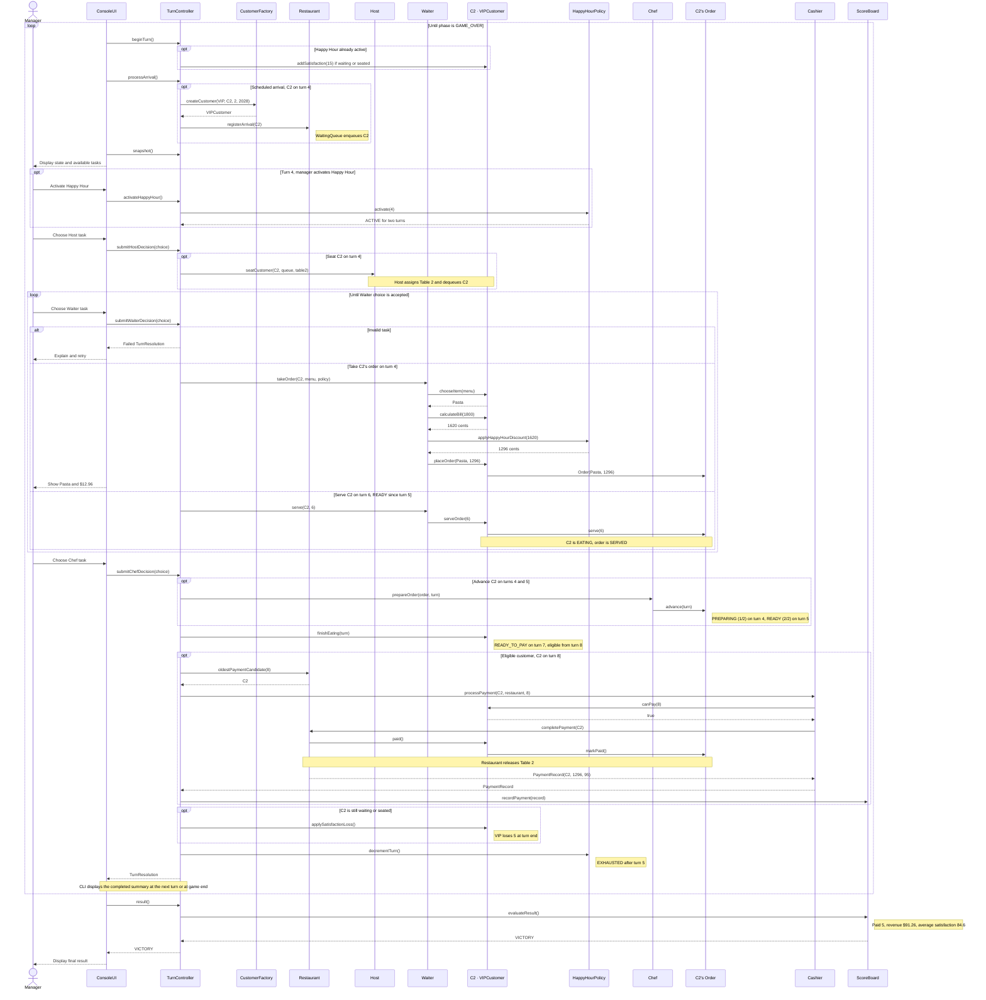

# Stage 3 sequence diagram

The [six submission diagrams](../../README.md#stage-3-submission-sequence-diagrams) show the VIP burger scenario from the video. The diagram below follows the CLI victory replay.

Follow the [seed 2026 Easy victory](../../README.md#instant-cli-tests).
C2 is the VIP arriving on turn 4 while C1 occupies Table 1. Activating Happy Hour
before C2 orders locks in $12.96 for Pasta ($18.00 × 0.9 × 0.8). With identical
staff choices and Happy Hour declined, C2 pays $16.20 with satisfaction 90
instead of 95.

